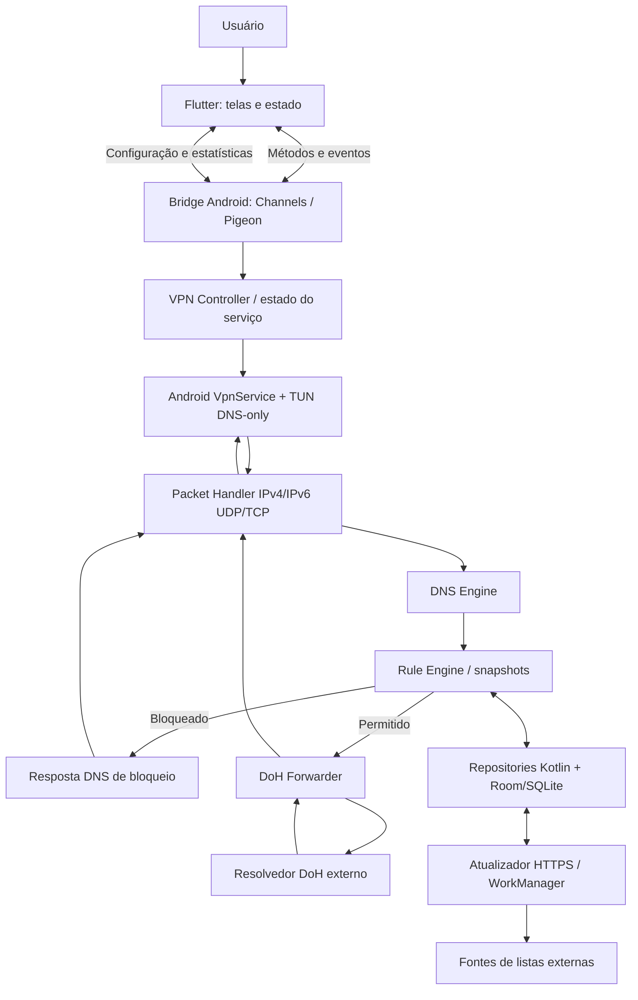
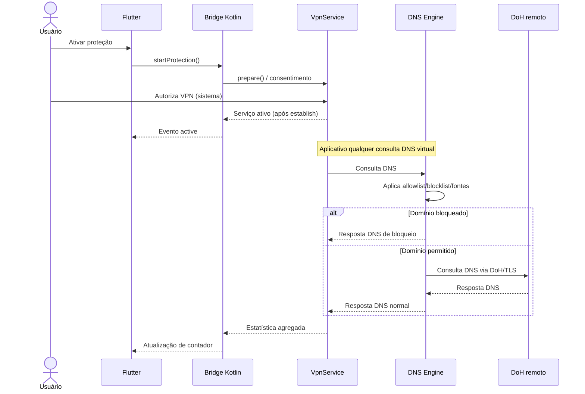

# ARQ — Arquitetura do FologneBlocker

> **Status:** arquitetura para implementação incremental do FologneBlocker.
> **Referências:** [`escopo.md`](./escopo.md) define o produto; [`status.md`](./status.md) define a ordem de implementação.

## 1. Decisão arquitetural

Aplicação **Android-first**, offline-first para regras já baixadas, dividida em:

- **Flutter/Dart:** interface, navegação, estado de telas e comandos.
- **Kotlin/Android:** proprietário do ciclo de vida da VPN, leitura/escrita do TUN, motor DNS, regras, armazenamento e atualizações.
- **Serviços externos:** resolvedor DNS-over-HTTPS (DoH) para consultas permitidas; HTTPS para atualizar fontes públicas de bloqueio.

**Não há servidor de aplicação próprio** (Django, Node, Firebase etc.) na versão inicial. O “backend” é um motor **nativo local**. O app não intercepta conteúdo HTTPS nem trabalha como proxy MITM.

## 2. Diagrama de componentes



**Regra fundamental:** a camada Flutter nunca lê diretamente o TUN nem decide se uma consulta DNS deve ser bloqueada. Toda decisão de rede acontece no Kotlin.

## 3. Diagrama da sequência principal



## 4. Estrutura inicial sugerida

```text
fologneblocker/
├── README.md
├── status.md
├── escopo.md
├── arq.md
├── PRIVACY.md
├── SECURITY.md
├── LICENSE                 # após decisão de compatibilidade
├── pubspec.yaml
├── lib/
│   ├── main.dart
│   ├── app/
│   │   ├── app.dart
│   │   └── routes.dart
│   ├── core/
│   │   ├── bridge/          # contrato nativo
│   │   ├── models/          # DTOs/estados de apresentação
│   │   └── theme/
│   └── features/
│       ├── home/
│       ├── filters/
│       ├── lists/
│       ├── statistics/
│       └── settings/
├── android/app/src/main/
│   ├── AndroidManifest.xml
│   └── kotlin/<package>/
│       ├── MainActivity.kt
│       ├── bridge/
│       │   └── NativeBridge.kt
│       ├── vpn/
│       │   ├── DnsVpnService.kt
│       │   ├── VpnController.kt
│       │   └── TunnelConfig.kt
│       ├── packet/
│       │   ├── PacketReader.kt
│       │   └── PacketWriter.kt
│       ├── dns/
│       │   ├── DnsPacketCodec.kt
│       │   ├── DnsEngine.kt
│       │   └── DohForwarder.kt
│       ├── rules/
│       │   ├── RuleEngine.kt
│       │   ├── RuleCompiler.kt
│       │   └── DomainNormalizer.kt
│       ├── data/
│       │   ├── AppDatabase.kt
│       │   ├── SettingsRepository.kt
│       │   ├── RulesRepository.kt
│       │   └── StatsRepository.kt
│       └── updates/
│           ├── BlocklistUpdater.kt
│           └── BlocklistUpdateWorker.kt
└── test/                    # testes Dart; testes Kotlin no android/
```

Esta estrutura é **sugestão**, não obrigação de criar classes vazias. Criar módulos conforme cada etapa de implementação.

A base separa a entrada Flutter (`lib/main.dart`), o tema (`lib/app/`), as telas (`lib/features/home/`) e o contrato da VPN (`lib/core/bridge/`). No Android, `MainActivity.kt` conduz o consentimento e delega a comunicação a `bridge/NativeBridge.kt` e o túnel a `vpn/DnsVpnService.kt`.

## 5. Responsabilidades por módulo

| Módulo | Responsabilidade | Não deve fazer |
|---|---|---|
| Flutter UI | Exibir estados, solicitar ações, validação visual | Ler pacotes de rede |
| NativeBridge | Comandos e eventos tipados, mapeamento de erros | Motor DNS ou regras |
| VpnController | Consentimento, transições e estado do serviço | Decidir bloqueios |
| DnsVpnService | Criar TUN, roteamento DNS-only, ciclo de vida | Consultar banco no hot path |
| Packet Handler | Interpretar/reconstruir IPv4/IPv6, UDP/TCP e checksums | Aplicar regras de negócio |
| DNS Engine | Fluxo da consulta, resposta e métricas | Renderizar telas |
| Rule Engine | Busca de domínios e precedência | Baixar regras durante consultas |
| DoH Forwarder | Resolver consultas permitidas com TLS | Manter histórico do usuário |
| Repositories | Dados locais, preferências e contadores | Manipular diretamente interface TUN |
| Updater | Baixar, validar e trocar snapshots de listas | Comprometer última lista válida |

## 6. Fluxo da VPN DNS-only

O serviço instala apenas rotas de host para os DNS virtuais IPv4 e IPv6. O leitor TUN usa um buffer de 1.281 bytes para uma MTU de 1.280, com uma consulta DoH em voo por vez e sem fila própria. O serviço usa `START_NOT_STICKY` e desativa VPN sempre ativa nas versões Android que respeitam essa configuração. [Guia de VPN do Android](https://developer.android.com/develop/connectivity/vpn).

1. A interface solicita `startProtection()` e exibe o texto de consentimento.
2. O Kotlin chama `VpnService.prepare()`; o Android apresenta autorização, se necessária.
3. Depois da permissão, o serviço chama `VpnService.Builder` para criar interface TUN.
4. O serviço informa um **DNS virtual** ao sistema (`addDnsServer`) e instala rotas específicas para esse IP (por exemplo `/32` IPv4 e `/128` IPv6), evitando adicionar rota padrão `0.0.0.0/0` ou `::/0`.
5. O Android encaminha ao TUN as consultas que efetivamente usam o DNS configurado pelo sistema e obedecem ao roteamento disponível.
6. O leitor TUN interpreta o pacote de entrada, extrai a mensagem DNS e envia ao motor.
7. O motor responde com bloqueio ou encaminha a consulta a DoH.
8. O Packet Writer gera o pacote de resposta válido no TUN.
9. Ao encerrar, os recursos são liberados e o estado é informado ao Flutter.

**Limites:** este desenho não captura todos os destinos/formatos de DNS. DNS privado, DoT/DoH próprio de aplicativos, IPs diretos e comportamentos de determinados fabricantes podem contornar o filtro. A configuração deve ser verificada em dispositivos reais e não deve prometer VPN completa ou firewall universal.

## 7. Protocolo DNS e encaminhamento

### 7.1. Leitura do TUN

- Validar versão IP, tamanhos, protocolos, endereços, portas e checksums.
- Suportar perguntas DNS comuns (A/AAAA) sem quebrar outros tipos.
- Tratar malformação, compressão DNS, EDNS(0), truncamento e limites de memória.
- DNS via UDP/53 é prioridade do primeiro protótipo; DNS via TCP/53 e IPv6 devem estar implementados e testados ou claramente registrados como limitações antes da versão estável.
- Evitar processamento paralelo que desordene respostas ou crie condições de corrida.

### 7.2. Encaminhamento DoH

O protótipo usa POST binário via OkHttp, Cloudflare por padrão e Google Public DNS como alternativa por sessão. O cliente usa os IPs IPv4/IPv6 publicados pelos provedores para bootstrap, preserva o hostname para TLS e protege o socket antes da conexão. Cada chamada tem prazo total de cinco segundos. Redirecionamentos e proxy HTTP estão desativados. Em falha de transporte ou resposta inválida, o serviço envia SERVFAIL e exibe um aviso. Uma resposta válida de sucesso ou NXDOMAIN limpa o aviso. A troca de rede ainda precisa de validação física. [RFC 8484](https://www.rfc-editor.org/rfc/rfc8484), [Cloudflare](https://developers.cloudflare.com/1.1.1.1/ip-addresses/) e [Google Public DNS](https://developers.google.com/speed/public-dns/docs/using).

O protótipo aceita UDP/53 sem fragmentação IP, opções IPv4 ou cabeçalhos de extensão IPv6. Se a resposta exceder o tamanho UDP anunciado por EDNS(0) ou a MTU, o motor devolve o bit TC e a pergunta original. A tentativa subsequente por TCP/53 ainda não é atendida. Respostas já truncadas no servidor são tratadas como falha.

- Protocolo: DNS-over-HTTPS sobre TLS, de acordo com endpoint suportado.
- Usar cliente HTTP com timeouts, certificados válidos e políticas de erro definidas.
- Chamar `VpnService.protect()` em sockets apropriados, evitando tráfego circular, inclusive nos casos em que a configuração de rotas mudar.
- Resolver o bootstrap do servidor DoH sem recorrer silenciosamente a DNS inseguro.
- Não usar fallback automático para DNS em texto puro; apresentar falha de resolução ao usuário caso o provedor configurado esteja indisponível.
- Identificar claramente o provedor: ele receberá as consultas permitidas, embora não exista backend próprio.

### 7.3. Decisão de bloqueio

Ordem de prioridade proposta:

1. **Allowlist manual**: permite o domínio, mesmo quando aparecer em listas externas.
2. **Blocklist manual**: bloqueia nomes personalizados não liberados.
3. **Listas externas ativadas**: bloqueiam anúncios/rastreadores e, opcionalmente, NSFW.
4. **Padrão**: encaminha ao DoH.

Os domínios são normalizados e as regras de subdomínio respeitam as fronteiras dos rótulos. Exemplo: a regra `ads.example.com` corresponde a `ads.example.com` e `sub.ads.example.com`, mas **não** a `notads.example.com`.

O motor devolve `NXDOMAIN` local, preserva o identificador e a pergunta e mantém EDNS(0) quando solicitado. Cada resposta escrita no TUN incrementa um contador em memória conforme o resultado. O motor decide a regra em cada consulta e opera sem cache de respostas próprio.

## 8. Atualização e indexação das listas

Fontes iniciais:

- HaGeZi Multi Normal: `https://cdn.jsdelivr.net/gh/hagezi/dns-blocklists@latest/wildcard/multi-onlydomains.txt`
- HaGeZi NSFW: `https://cdn.jsdelivr.net/gh/hagezi/dns-blocklists@latest/wildcard/nsfw-onlydomains.txt`

Estratégia:

1. Download HTTPS assíncrono com limite de tamanho, timeout e identificação da origem.
2. Parse como texto de domínios; rejeitar conteúdo inválido; remover duplicados.
3. Salvar em arquivo temporário/armazenamento persistente, preservando a versão antiga.
4. Construir estrutura imutável para busca (por exemplo, árvore de sufixos invertidos ou conjunto com verificação de sufixos por rótulo).
5. Fazer **swap atômico** da estrutura em memória para novas consultas.
6. Registrar data, versão/hash, quantidade de regras e status.
7. Se falhar: manter a versão anterior e sinalizar erro, sem apagar proteção existente.
8. WorkManager para atualização periódica; usuário também pode atualizar manualmente.

**Licenciamento:** HaGeZi publica listas em GPL-3.0. Revisar a licença e condições de redistribuição antes de incorporar qualquer snapshot ao APK. Não presumir que código do aplicativo e dados externos possuem automaticamente a mesma licença.

A implementação agenda atualização diária com rede conectada pelo WorkManager e permite atualização manual por fonte. O download tem limite de 16 MiB e 45 segundos por lista. O parser valida UTF-8, domínios e a contagem declarada quando presente. Depois de validar, o aplicativo sincroniza um arquivo temporário e o renomeia sobre o arquivo anterior no mesmo diretório. O motor publica um snapshot após a troca. SQLite guarda regras próprias, categorias e metadados da última tentativa. A contagem, o hash e a data de sucesso são derivados do arquivo válido.

## 9. Modelo de dados local (conceitual)

| Entidade | Campos sugeridos | Observações |
|---|---|---|
| `AppSettings` | `id`, `dohEndpoint`, `filterEnabled`, `nsfwEnabled`, `updatedAt` | Configurações persistentes |
| `BlocklistSource` | `id`, `name`, `url`, `category`, `enabled`, `lastSuccess`, `lastError`, `contentHash` | Fonte externa, sem misturar conteúdo e metadados |
| `CustomDomainRule` | `id`, `domain`, `action` (ALLOW/BLOCK), `createdAt` | Domínio normalizado; regra única por ação/domínio |
| `DailyStatistics` | `day`, `total`, `allowed`, `blocked`, `errors` | Contadores agregados, nunca números simulados |
| `FilterSnapshot` | conjunto indexado e versão | Preferencialmente somente em memória |

**Não persistir histórico de consultas por domínio no MVP.** Caso essa funcionalidade seja adicionada futuramente, exigir opção explícita, retenção curta e limpeza fácil.

## 10. Comunicação Flutter/Kotlin

A versão 1 usa `com.fologne.fologneblocker/vpn` para comandos e consulta e `com.fologne.fologneblocker/vpn_state` para eventos. O snapshot inclui `version`, `state` e `reason` opcional. Uma nova assinatura recebe o snapshot atual. Os comandos pedem uma transição e o resultado operacional chega pelo estado publicado pelo Kotlin.

Contrato proposto (nomes podem mudar, desde que sejam consistentes):

**Métodos Flutter → Kotlin:**
- `getProtectionState()`
- `startProtection()`
- `stopProtection()`
- `getStatistics()`
- `getFilterSettings()` / `updateFilterSettings()`
- `getBlocklistSources()` / `updateBlocklists()`
- `getCustomRules()` / `addCustomRule()` / `deleteCustomRule()`
- `resetStatistics()`

**Eventos Kotlin → Flutter:**
- `ProtectionStateChanged(state, reason?)`
- `StatisticsChanged(aggregate)`
- `BlocklistUpdateStateChanged(sourceId, status, message?)`

A decisão de iniciar a VPN depende do resultado da **autorização do sistema**. O evento `active` só pode ser enviado quando o serviço estiver efetivamente estabelecido, e não quando o usuário simplesmente tocar no botão.

Estados: `idle` → `permission_required` → `starting` → `active` → `stopping` → `idle`; estados excepcionais: `error` e `revoked`.

## 11. Threads, concorrência e performance

- TUN em thread/coroutine de I/O, nunca na thread principal da interface.
- Fluxo de consultas com limite de concorrência e timeouts explícitos.
- Snapshot de regras imutável para consultas rápidas e atualização sem bloquear o hot path.
- Escrita de estatísticas em lotes, reduzindo I/O e consumo de bateria.
- Cache de respostas em memória somente se respeitar TTL e sem burlar mudanças de regra.
- Tratamento de cancelamento e fechamento de sockets após troca de rede ou encerramento da VPN.

## 12. Segurança e privacidade

- Sem root, MITM, certificados CA adicionais ou decodificação de conteúdo HTTPS.
- Sem analytics, login ou servidor de telemetria próprio no MVP.
- Dados de configuração protegidos pelos mecanismos de sandbox do Android.
- Nenhum domínio/IP identificável em logs de produção por padrão.
- Política de privacidade transparente: os domínios permitidos são consultados no provedor DoH escolhido.
- Proteger contra downloads malformados, listas excessivamente grandes, estouro de memória e URLs não confiáveis.
- Validar endpoints DoH e usar HTTPS com verificação TLS.
- Respeitar `VpnService.prepare()`, `onRevoke()`, notificações e regras de foreground services da versão Android suportada.

## 13. Testes por camada

| Camada | Testes obrigatórios |
|---|---|
| Normalização/regras | Correspondência de domínio, subdomínio, prioridade e falsos positivos |
| DNS codec | Mensagens A/AAAA, IDs, compressão, respostas e pacotes inválidos |
| Packet handler | IPv4/IPv6, UDP, checksums, tamanhos e TCP conforme suporte |
| DoH | Sucesso, timeouts, TLS inválido, bootstrap e troca de rede |
| VPN | Consentimento, ativo/inativo, revogação, reabertura e outra VPN |
| Banco/listas | Persistência, atualização atômica, rollback e fontes malformadas |
| Flutter | Estados reais, navegação, configurações e recuperação de erro |
| Integração | Domínio bloqueado/permitido e contadores observados em Android real |

## 14. Decisões abertas (registrar antes da implementação correspondente)

Na base de desenvolvimento, o Flutter 3.44.0 fornece `minSdk` 24 (piso do template) e `targetSdk` e `compileSdk` 36 (Android 16). Fixar a versão do Flutter mantém esses valores e as ferramentas do template reproduzíveis. A configuração gerada usa Dart 3.12.0, Gradle 9.1.0, Android Gradle Plugin 9.0.1, Kotlin 2.3.20 e JDK 17. A faixa de compatibilidade do aplicativo depende dos testes em dispositivo. Referências [código do Flutter 3.44.0](https://github.com/flutter/flutter/blob/3.44.0/packages/flutter_tools/lib/src/android/gradle_utils.dart) e [requisitos de API do Android](https://developer.android.com/google/play/requirements/target-sdk).

- Identidade visual e licença do código.
- Comportamento quando DNS privado estiver ativo ou o app terceiro utilizar DoH próprio.
- Suporte DNS TCP/53 e compatibilidade IPv6 em aparelhos reais.
- Política de resposta para domínios bloqueados e cache.
- Frequência de atualização e gerenciamento de listas grandes.
- Compatibilidade com VPN sempre ativa: **não** prometer kill switch global de tráfego com rotas DNS-only.
- Requisitos legais e de publicação caso a distribuição seja expandida para lojas.

## 15. Princípios para o Codex

1. Implementar por etapas do `status.md`, sem simular funcionalidade central.
2. Não considerar VPN iniciada como prova de bloqueio.
3. Não inventar estatísticas, cobertura ou testes em aparelho real.
4. Não colocar persistência ou lógica de bloqueio dentro do Flutter.
5. Não adicionar servidor próprio sem aprovação explícita de escopo.
6. Documentar limitações e mudanças arquiteturais antes de expandir o projeto.
7. Registrar evidência de testes antes de marcar `[x]` nas tarefas.
